<!-- START:header -->
# Hi, I'm Parker Ortanes 👋

**Finance & Accounting @ CU Boulder Leeds '28** · 📍 Boulder, CO

[LinkedIn](https://www.linkedin.com/in/parker-ortanes/)

Finance & Accounting student at the Leeds School of Business (Leeds Scholars). Interested in investment banking, valuation, and building tools that make financial work faster.
<!-- END:header -->

<!-- START:now -->
## 📌 Right now

- 🔜 Incoming **Investment Banking Summer Analyst** at Canaccord Genuity (Consumer Group), starting May 2027
- 🎓 Studying at **University of Colorado Boulder, Leeds School of Business**
- ✈️ Heading to **Universidad Carlos III de Madrid** in Madrid, Spain in Jan 2027
<!-- END:now -->

<!-- START:news -->
## 📰 Latest updates

- **Oct 2026**: Accepted a Summer 2027 Investment Banking Analyst offer at Canaccord Genuity (Consumer Group, New York) 🆕
<!-- END:news -->

<!-- START:experience -->
## 💼 Experience

| Role | Firm | Location | Dates | |
|---|---|---|---|---|
| Investment Banking Summer Analyst · Consumer Group | Canaccord Genuity | New York, NY | May 2027 – Aug 2027 | Incoming |

## 🎓 Education

- **Universidad Carlos III de Madrid**, Exchange semester (Jan 2027 – May 2027)
- **University of Colorado Boulder, Leeds School of Business**, B.S. Business, Finance & Accounting · Leeds Scholars (Aug 2024 – May 2028)

## 🧰 Skills

`Financial modeling` · `Valuation (DCF, comps)` · `Excel` · `Python`
<!-- END:experience -->

<!-- START:activity -->
## 🛠️ What I've been building

- [**ai-radar-digest**](https://github.com/parkerortanes/ai-radar-digest): Daily AI Radar digest: new AI tools, skills and MCP servers (published automatically) · `HTML` · updated Nov 02
<!-- END:activity -->

---
<!-- START:updated -->
🤖 Auto-updated Nov 03, 2026
<!-- END:updated -->
